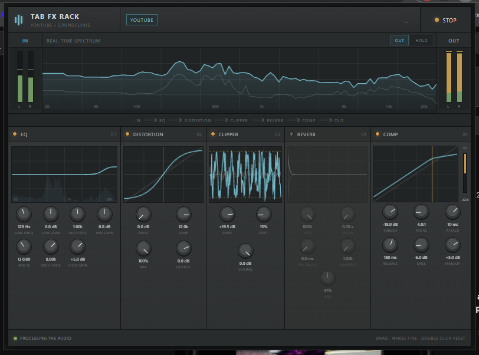

# Tab FX Rack

YouTube / SoundCloud の再生音声に、ブラウザ内でリアルタイムにエフェクトをかける Chrome / Chromium 向け拡張機能です。外部ライブラリやビルド作業は必要ありません。

## 主な機能

- 5種類のエフェクトを個別にON/OFFし、ノブでパラメータを調整
- 入出力のステレオレベルメーター、リアルタイム周波数スペクトラム（IN / OUT切替、HOLD）
- EQの周波数特性、歪みの伝達特性、クリッパーの波形、リバーブの減衰、コンプレッサーの圧縮カーブ・ゲインリダクションを表示
- 設定をブラウザ内の `chrome.storage.local` に保存
- 処理対象のタブを切り替え可能（同時に処理するのは1タブ）

音声の処理順：**EQ → Distortion → Clipper → Reverb → Compressor**

## 動作環境

- Google Chrome または互換の Chromium ブラウザ（Chrome 116以降相当）
- 対応サイト：YouTube、SoundCloud
- Manifest V3 / Web Audio API を使用

## インストール

1. [Releases](https://github.com/szkr01/tab-fx-rack/releases) から `tab-fx-rack.zip` を入手して展開します。
2. Chromeで `chrome://extensions` を開き、「デベロッパー モード」を有効にします。
3. 「パッケージ化されていない拡張機能を読み込む」を選択します。
4. 展開した `tab-fx-rack` フォルダ（`manifest.json` がある階層）を指定します。

## 使い方

1. YouTubeまたはSoundCloudのタブを開き、音声を再生します。
2. ツールバーから **Tab FX Rack** を開いて **START** を押します。
3. 各エフェクトの小さな丸いスイッチで有効・無効を切り替え、ノブを操作します。
4. 終了時は **STOP** を押します。別の対応タブへ対象を移すときは **MOVE** を押します。

ノブは上下ドラッグで調整できます。Shiftキーを押しながらドラッグすると微調整、ホイールと矢印キーでも調整でき、ダブルクリックで初期値に戻ります。

## エフェクトと調整範囲

| エフェクト | パラメータ |
| --- | --- |
| **EQ** | Low: 周波数 40–500 Hz / ゲイン ±15 dB、Mid: 150 Hz–8 kHz / ±15 dB / Q 0.20–8.00、High: 2–16 kHz / ±15 dB |
| **Distortion** | Drive 0–30 dB、Tone 800 Hz–20 kHz、Mix 0–100%、Output −18～+6 dB |
| **Clipper** | Drive 0–24 dB、Softness 0–100%、Ceiling −12～0 dB |
| **Reverb** | Size 0–100%、Decay 0.2–8秒、Pre-delay 0–120 ms、Damping 1–20 kHz、Mix 0–100% |
| **Compressor** | Threshold −60～0 dB、Ratio 1:1～20:1、Attack 0.1～100 ms、Release 20～1000 ms、Knee 0～40 dB、Makeup −12～+12 dB |

広い範囲の周波数・時間ノブは対数スケールで動作します。

## ファイル構成

| ファイル | 役割 |
| --- | --- |
| `manifest.json` | Chrome拡張の設定 |
| `background.js` | タブのキャプチャ開始・停止とメッセージ処理 |
| `offscreen.html` / `offscreen.js` | Web Audioによる音声処理と分析 |
| `popup.html` / `popup.css` / `popup.js` | 操作画面とグラフ描画 |
| `icons/` | 拡張機能アイコン |

## 制限事項

- 対応サイト以外のタブではSTARTできません。
- 処理対象は同時に1タブです。
- GitHub ReleaseのZIPは手動読み込み用です。Chrome ウェブストアへの掲載は行っていません。
